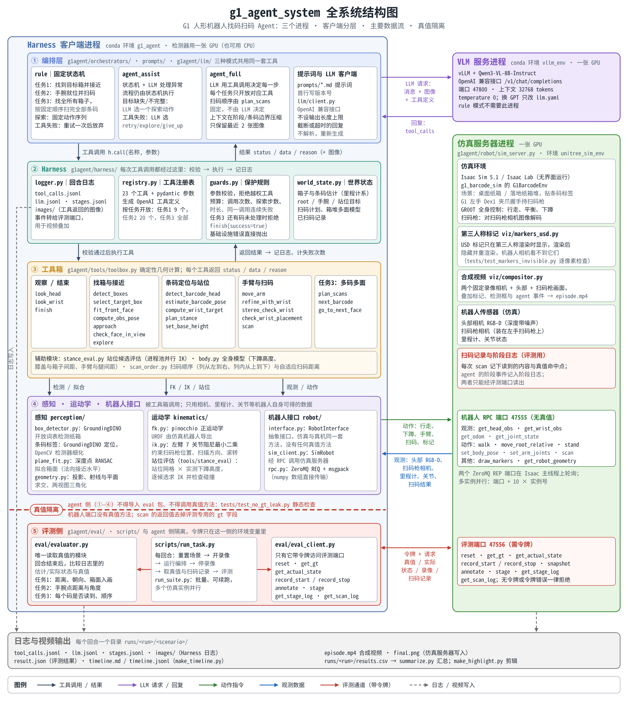

# g1_agent_system：G1 人形机器人找码扫码 Agent 系统

让 Unitree G1 人形机器人在仓库里找到纸箱、定位条码标签、走过去并用左手的手持扫码枪逐个扫码。系统运行在 [g1_barcode_sim](https://github.com/yuxuanli224284/g1_barcode_sim)（Isaac Sim 5.1 / Isaac Lab）仿真环境上：几何计算都放在确定性的工具里，由规则状态机或视觉语言模型（Qwen3-VL-8B，经 vLLM 提供服务）通过工具调用编排。



**详细文档**（每个组件的实现、从最初版本开始的每一次改进、实验记录）：<https://yuxuanli224284.github.io/g1_docs/agent_system/>（源文件在 [`docs/`](docs/)，Sphinx）。

## 主要内容

| 部分 | 说明 |
|---|---|
| 三个进程 | 仿真服务器（G1BarcodeEnv + ZeroMQ RPC）、VLM 服务（vLLM 部署 Qwen3-VL-8B-Instruct，bf16，OpenAI 兼容接口）、Harness 客户端（感知、工具、编排、评测） |
| 编排模式 | `rule` 固定状态机；`agent_assist` 状态机 + LLM 只处理异常；`agent_full` LLM 通过工具调用决定每一步 |
| 感知 | GroundingDINO 检测箱子和条码标签，深度平面拟合求箱面，下蹲补看低处标签，扫码枪相机近距离修正 |
| 运动 | pinocchio 正运动学 / 阻尼最小二乘 IK，站位评估，GR00T WBC 行走与下蹲（仿真侧） |
| 任务 | 任务 1 找箱并接近；任务 2 条码前手腕就位；任务 3 找到所有箱子并按固定顺序扫完所有码（含四面箱堆） |
| 评测 | 只有评测器能通过带令牌的端口读取真值；合成视频、时间线和汇总报告 |

## 快速开始

需要先按 g1_barcode_sim 的文档装好仿真环境，并把两个仓库并排放置。三个 conda 环境的完整安装步骤见 [安装与运行](docs/installation.md)。

```bash
git clone https://github.com/yuxuanli224284/g1_agent_system.git && cd g1_agent_system
mkdir -p runs
setsid nohup bash scripts/start_sim_server.sh > runs/sim_server.log 2>&1 &   # 仿真服务器
setsid nohup bash scripts/start_vllm.sh > runs/vllm.log 2>&1 &               # VLM 服务（rule 模式不需要）

conda activate g1_agent
export G1_EVAL_TOKEN=$(cat runs/.eval_token)
python -m pytest tests                                                   # 单元测试
python scripts/run_task.py --scenario t2_L0_0000 --mode rule             # 桌面场景，规则编排
python scripts/run_task.py --scenario stack4c_L0_0001 --mode agent_full  # 纸箱箱堆，LLM 全程决策
```

## 目录结构

```
g1agent/robot/          RobotInterface、ZeroMQ RPC、仿真服务器
g1agent/perception/     箱子 / 条码检测、平面拟合、几何
g1agent/kinematics/     正运动学与 IK（pinocchio）
g1agent/tools/          工具箱（每个工具返回 status / data / reason）、站位评估、扫码顺序
g1agent/harness/        工具注册表、保护规则、世界状态、日志
g1agent/llm/            OpenAI 兼容客户端（截断与超时后重新生成）
g1agent/orchestrators/  rule / agent_assist / agent_full
g1agent/eval/           评测器（唯一读取真值的模块）
g1agent/viz/            第三人称标记、合成视频
prompts/                LLM 提示词（第一行是版本号）
configs/                系统、机器人、感知、任务、LLM、可视化配置
scripts/                启动、运行、批量评测、汇总、视频剪辑
tests/                  单元测试
docs/                   文档源文件
```

## 许可证

本仓库代码使用 MIT License（见 [`LICENSE`](LICENSE)）。`assets/g1_dex1_scanner.urdf` 由 [unitree_sim_isaaclab](https://github.com/unitreerobotics/unitree_sim_isaaclab)（Apache-2.0）的机器人模型导出；Qwen3-VL 与 GroundingDINO 的权重遵循各自的许可证，不随本仓库分发。
