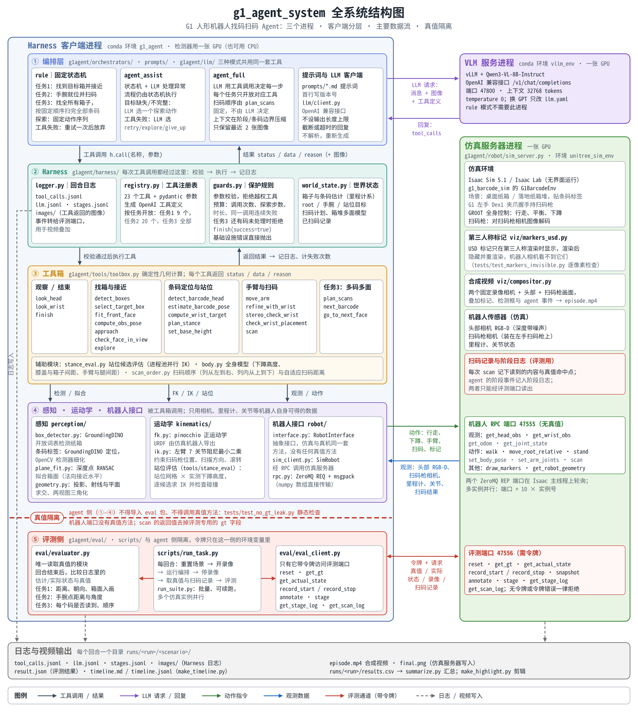
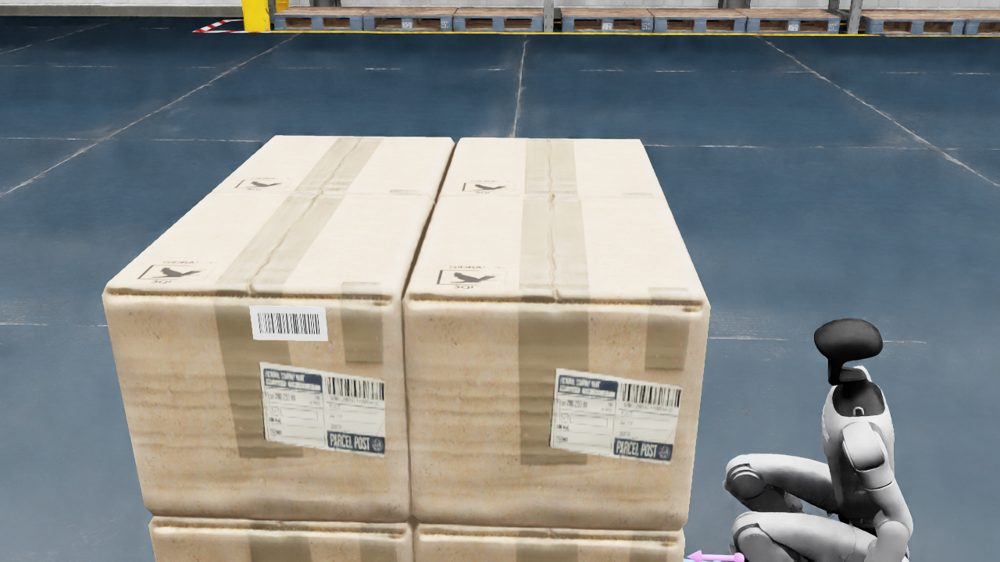

# 系统总体结构



本页介绍 g1_agent_system 的整体结构：系统由哪三个进程组成、代码怎样分层、一个 episode 从 reset 到 finish 的完整数据流、三种编排模式的区别，以及贯穿全系统的设计原则。各组件的实现细节见对应的组件页，本页只写它们之间怎样配合。文中路径都相对于仓库根目录 `g1_agent_system/`。

## 作用与在系统中的位置

系统的目标是让 Unitree G1 人形机器人在仓库场景里找到纸箱、定位条码标签，走到合适的位置，再把左手持的扫码枪放到条码前扫码。仓库实现了三个任务：

| 任务 | 内容 | 配置 |
|---|---|---|
| 任务 1 | 找到目标箱子（场景指定左边或右边那个），走到能把整个箱面放进头部相机视野的观察位姿 | `configs/task1.yaml` |
| 任务 2 | 定位一个条码，把扫码枪枪口放到条码前 0.20 m 并对准，然后扫码 | `configs/task2.yaml` |
| 任务 3 | 任务 1 + 任务 2 的合并：找到所有箱子，按"列从左到右、列内从上到下"的固定顺序把每个条码扫一次；箱堆场景可要求扫四个侧面 | `configs/task3.yaml`（继承 task1、task2） |

整个系统由三个独立进程组成，彼此只通过网络接口通信：

| 进程 | conda 环境 | 启动方式 | 对外接口 | 里面运行什么 |
|---|---|---|---|---|
| 仿真服务器 | `unitree_sim_env` | `scripts/start_sim_server.sh` | ZeroMQ REP：robot port `47555 + 10·i`，eval port `47556 + 10·i` | 仿真环境 `G1BarcodeEnv`（Isaac Sim，无界面，来自仿真包 `g1_barcode_sim`，行走控制器在仿真包内）、回合状态 `Episode`（录像、阶段日志、扫码日志）、USD 诊断标记 |
| VLM 服务 | vLLM 环境 | `scripts/start_vllm.sh` | HTTP，OpenAI 兼容接口 `http://127.0.0.1:47800/v1` | vLLM 0.11.2 加载 `Qwen/Qwen3-VL-8B-Instruct`，工具调用解析器 `hermes`，上下文长度 32768 |
| Harness 客户端 | `g1_agent` | `scripts/run_task.py`（单个场景）、`scripts/run_suite.py`（整套测试集） | 不监听端口 | 感知（GroundingDINO、平面拟合）、运动学（pinocchio）、工具箱 `Toolbox`、守门层 `Harness`、编排器、LLM 客户端、评测器 |

`i` 是实例号，取自环境变量 `SIM_INSTANCE`（默认 0）。端口步长 `instance_port_stride: 10` 写在 `configs/system.yaml` 里，用于在同一台机器上并行跑多组"仿真服务器 + 客户端"做批量评测。rule 模式不调用 LLM，可以不启动 VLM 服务。

三个进程之间的接口：

| 调用方 → 被调方 | 通道 | 能做什么 | 实现 |
|---|---|---|---|
| 工具箱 → 仿真服务器 | robot port（无令牌） | `RobotInterface` 规定的全部操作：取图、读关节和里程计、行走、下蹲、动手臂、扫码、画标记。返回值里没有真值 | `g1agent/robot/interface.py`、`sim_client.py`、`rpc.py` |
| 运行器 / 评测器 → 仿真服务器 | eval port（需要令牌） | 回合控制（reset）、读真值和实际状态、开关真值标记、截图、录像、记录阶段和 agent 事件、读阶段日志和扫码日志 | `g1agent/eval/eval_client.py` |
| 编排器 → VLM 服务 | HTTP（OpenAI `chat.completions` + `tools`） | 发送消息历史、图像和工具 schema，取回工具调用 | `g1agent/llm/client.py` |



*图：评测端口 `snapshot` 在 episode 结束时截的第三人称图像。这个视角只给人看和评测用，机器人自己的相机看不到诊断标记。*

## 当前实现

### 1. 三个进程

#### 1.1 仿真服务器（`g1agent/robot/sim_server.py`）

- **启动**：`scripts/start_sim_server.sh` 先读取仓库根目录的 `local.env`（本机设置，不入库；存在时才读），再确保 `runs/.eval_token` 存在（没有就在 `umask 077` 下用 `secrets.token_hex(16)` 生成，只有所有者可读写），把它导出成环境变量 `G1_EVAL_TOKEN`，再激活 `unitree_sim_env` 环境启动 `python -m g1agent.robot.sim_server`。GPU 有三条来源：设置了 `SIM_GPU` 时直接用这张共享的卡；否则如果 `local.env` 定义了 shell 函数 `gpu_launch`，就用它包装启动命令（我们机器上的实现是通过共享 GPU 排队工具租一张卡，`-n 1`，默认预计时长 8h）；两者都没有时沿用继承的 `CUDA_VISIBLE_DEVICES`。
- **环境**：`G1BarcodeEnv("scenario", headless=True, seed=0, config_overrides=...)`。覆盖项只有 `robot.mode_policies`（当前为 `null`，因为行走控制器 GR00T 自己在 Balance 和 Walk 两个网络之间切换）和录像相机开关。
- **两张方法表**：robot port 对应方法表 `R`，eval port 对应方法表 `E`。两个 REP socket 由同一个线程用 `poller.poll(1000)` 轮询，原因是源码注释写的"Isaac Sim must be driven from its main thread"。eval port 上令牌不对时回复 `eval port: bad or missing token`；方法名不在表里回复 `unknown method`。
- **出错不退出**：方法抛异常时，主循环用 `except Exception` 捕获，把异常类型、信息和完整 traceback 回复给调用方并打印到日志，服务器继续服务。客户端 `RpcClient.call` 看到带 `traceback` 的错误回复会重新抛出 `RuntimeError`，所以错误对调用方是可见的。
- **退出**：收到 eval port 的 `shutdown` 后，先回复，再关闭 socket（`linger=0`）、`ctx.term()`、刷新输出，最后 `os._exit(0)`。不调用 `env.close()`，因为它在 socket 打开时可能卡住。
- **回合状态 `Episode`**：保存 agent 事件、阶段记录（`stages` 只保留每个阶段名第一次出现的记录，`stage_log` 记录每一次）、robot port 上的全部扫码记录（含真值），以及合成录像。录像通过 `env.step_hooks` 在每个策略步被调用，每 `every` 步写一帧，视频时间与仿真时间一一对应。

#### 1.2 VLM 服务（`scripts/start_vllm.sh`）

- 从 `configs/system.yaml` 读端口 `47800`、`gpu_memory_utilization`、`max_model_len: 32768`，从 `configs/llm.yaml` 读模型名，离线加载权重（`HF_HUB_OFFLINE=1`）。
- 关键参数：`--enable-auto-tool-choice --tool-call-parser hermes`（Qwen 聊天模板的工具调用格式，由 `scripts/smoke_vlm.py` 验证）；`--limit-mm-per-prompt '{"image": 8, "video": 0}'`。
- 取卡方式和仿真服务器一样先读 `local.env`：没有设置 `VLLM_GPU` 时，若定义了 `gpu_launch` 就由它包装（我们机器上是通过共享 GPU 排队工具租一张卡），否则沿用继承的 `CUDA_VISIBLE_DEVICES`，用 `system.yaml` 的 `gpu_memory_utilization`；设置 `VLLM_GPU` 时进入"共享卡模式"，必须同时给出 `VLLM_KV_GIB` 和 `VLLM_GMU`，并加 `--kv-cache-memory-bytes` 和 `--enforce-eager`（原因见演进记录 v4）。
- 上下文长度 32768 是显存方面的设置。系统任何地方都不设输出长度上限（见第 5 节）。

#### 1.3 Harness 客户端

客户端是一个普通的 Python 进程，包含除仿真和 LLM 推理以外的全部逻辑。入口是 `scripts/run_task.py` 的 `make_episode_runner(device)`：它把重的部分（检测器、运动学、两个 RPC 客户端、全部配置）只加载一次，返回一个 `run(scenario, mode, ep_dir, video, task)` 函数，`run_suite.py` 用它连续跑一整套场景。GroundingDINO 检测器在客户端里运行（`system.yaml` 中 `detector_device: cuda`），所以客户端也要绑定一张 GPU（见演进记录 v8）。

#### 1.4 资源占用

三个进程可以放在同一张共享的 GPU 上。开发日志里一次 agent_full 运行的显存记录：vLLM 约 33.8 GB，仿真服务器和客户端各约 5 GB。单个仿真实例实测占 4767 MiB，批量脚本据此按每个实例 5000 MiB 预留，另外始终给卡上的其他任务留 4096 MiB 余量（这个余量是我们自己定的数值，没有测量依据）。

### 2. 模块分层

代码按依赖方向从下到上分为七层。下层基本不导入上层，唯一的例外是工具层从 `g1agent/harness/world_state.py` 导入 `WorldState` 等估计量数据类；评测包和可视化包在旁路，算法层不能导入评测包。

| 层 | 目录 | 主要内容 | 被谁使用 |
|---|---|---|---|
| 公共 | `g1agent/common/` | `config.py`（YAML 加载与 `inherits` 继承，父配置冲突直接报错）、`serialization.py`（msgpack + numpy 编码）、`transforms.py`（SE(3) 工具，`T_a_b` 命名约定） | 所有层 |
| 机器人接口 | `g1agent/robot/` | `RobotInterface` 抽象类、`RpcClient`（ZeroMQ REQ）、`SimRobot`（仿真实现）、`sim_server.py`（在仿真进程里运行） | 工具层 |
| 感知 / 运动学 | `g1agent/perception/`、`g1agent/kinematics/` | GroundingDINO 开放词表检测（`box_detector.py`）、条码定位（`barcode_detector.py`）、RANSAC 箱面拟合（`plane_fit.py`）、相机几何（`geometry.py`）；pinocchio 正运动学（`fk.py`）和左臂阻尼最小二乘 IK（`ik.py`），模型是从仿真机器人导出的 URDF | 工具层 |
| 工具 | `g1agent/tools/` | `Toolbox`（全部工具，22 个对外工具加内部辅助）、`body.py`（下蹲模型）、`stance_eval.py`（站位候选评估，可并行）、`scan_order.py`（扫码顺序和自适应扫码距离，纯函数） | Harness |
| Harness | `g1agent/harness/` | `registry.py`（工具名 → 参数模型和描述，按任务的白名单，OpenAI schema 生成）、`guards.py`（`Harness.call`：预算、白名单、参数校验、语义守卫、重试上限、执行、日志、任务 3 记账）、`world_state.py`（`WorldState`，里程计坐标系下的全部估计量）、`logger.py`（`EpisodeLogger`） | 编排器 |
| 编排 / LLM | `g1agent/orchestrators/`、`g1agent/llm/` | `rule.py`（`Task1` / `Task2` / `Task3` 状态机）、`agent_assist.py`、`agent_full.py`、`common.py`（提示词加载、LLM 日志）；`LLMClient`（截断和超时后重抽）；提示词在 `prompts/`，首行是版本号 | 运行脚本 |
| 运行脚本 | `scripts/` | `run_task.py`、`run_suite.py`、`summarize.py`、`make_timeline.py`、自检脚本、启动脚本、批量评测脚本 | 人 |
| 旁路：评测 | `g1agent/eval/` | `EvalClient`（带令牌）、`evaluator.py`（唯一读取真值的模块）、`scan_order.py`（与工具层同一规则的独立副本） | 运行脚本 |
| 旁路：可视化 | `g1agent/viz/` | `markers_usd.py`（仿真内的 USD 标记，只在第三人称渲染时显示）、`compositor.py`（合成视频的取景和绘制，纯 numpy/cv2/PIL） | 仿真服务器 |

层间约定：

- **工具返回格式统一**：每个工具都返回 `{"status": "ok" | "fail" | "partial", "data": {...}, "reason": str}`，浮点数四舍五入到 3 位，图像只通过 `look_head` / `look_wrist` 作为附件返回。行走结果只保留 `MOVE_LOG_KEYS` 中的字段，仿真回复里给评测用的真值位移不会进入日志或交给 LLM。
- **坐标系**：harness 只用里程计系（`odom`）和根坐标系（`pelvis`）。感知在拍摄时刻的根坐标系里完成，结果存进里程计系的 `WorldState`。相机位姿由关节状态经正运动学算出。
- **真值隔离的静态检查**：`tests/test_no_gt_leak.py` 遍历 `orchestrators/ tools/ perception/ harness/ kinematics/ llm/` 和机器人客户端的语法树，禁止导入评测包和仿真包，禁止出现 `get_gt`、`get_actual_state`、`EvalClient`、`evaluate` 等名字。

### 3. 一次 episode 的完整数据流

下面按 `scripts/run_task.py` 的 `run()` 函数顺序，写一个 episode 从 reset 到出结果的全过程。括号里标出这一步发生在哪个进程、走哪个通道。

```text
run_task.run(scenario, mode, ep_dir)
 ├─ 1 读场景、确定任务号                       [客户端]
 ├─ 2 建 EpisodeLogger(on_event=...)           [客户端]  事件 → eval port: stage / annotate
 ├─ 3 ev.reset(sc)                             [eval port → 仿真] Episode.reset, 清标记, env.reset
 ├─ 4 set_gt_markers(True); record_start(...)  [eval port → 仿真] 开始合成录像
 ├─ 5 Toolbox(robot, det)  → 新的 WorldState   [客户端]
 ├─ 6 Harness(tb, task, budget, log, limits)   [客户端]
 ├─ 7 编排器运行，直到 Harness.finished 或出错
 │     每一步: 编排器 → Harness.call → Toolbox → SimRobot ─robot port→ 仿真
 │             (agent 模式) 编排器 → LLMClient ─HTTP→ vLLM
 │             日志: tool_calls.jsonl / llm.jsonl / stages.jsonl / images/
 ├─ 8 record_stop; snapshot(final.png)         [eval port → 仿真]
 ├─ 9 get_gt / get_actual_state / get_stage_states / get_scan_log / get_stage_log  [eval port]
 ├─10 evaluate(task, gt, actual, ws, stages, scan_log)  [客户端，评测器]
 └─11 写 result.json；build_timeline → timeline.md / timeline.jsonl
```

逐步说明：

1. **场景和任务号**。`load_scenario(scenario)` 从仿真包的测试集读场景描述。`--task` 可以覆盖场景自带的任务号（例如把一个任务 1 场景当作任务 3 跑），只影响 agent 和评测一侧，仿真按原场景 reset。任务号不在 `(1, 2, 3)` 里时抛 `ValueError`，不会退回到别的任务。
2. **日志与事件**。`EpisodeLogger(ep_dir, on_event)` 为本 episode 建目录。`on_event` 回调把 harness 的事件转发给仿真服务器：`stage` 类事件调用 eval port 的 `stage`，其他事件（工具调用、LLM 回复）调用 `annotate`，用于合成视频的叠加层。`task1_end` 阶段到来时，运行器另外保存一份当时的 `ws.root_target`，因为任务 3 的扫码阶段会覆盖它，而评测任务 1 部分要用阶段结束那一刻的估计。eval port 返回错误时 `_eval_rpc` 会抛 `RuntimeError`，不会把错误当数据用。
3. **reset**。仿真端先 `ep.reset()`（如果上一回合还在录像就先停掉），再清空标记、`env.reset(scenario=...)`。
4. **录像**。打开真值标记显示（只在第三人称渲染时出现，例如结束时的 `final.png` 快照；合成录像里的标记是 2D 叠加层，不受这个开关影响），`record_start` 检查录像相机、场景和扫码枪相机都已就绪，缓存真值目标点，按场景摆好两台固定录像相机，打开 H.264 写入器和 `.frames.jsonl` 帧索引。
5. **工具箱**。每个 episode 新建一个 `Toolbox`，因此 `WorldState` 从空开始；检测器和运动学模型复用。任务 3 且场景要求 `scan_faces == "all"` 时设置 `tb.multi_face = True`。这是任务指令，不是真值。
6. **Harness**。用该任务配置的 `budget`（如 `max_tool_calls: 40`、`max_explore_steps: 6`、`max_retries_per_tool: 2`、`max_wall_s: 1800`）和 `robot.yaml` 的 `limits` 构造。目标选择器：任务 3 用 `"all"`，任务 1、2 用场景指定的 `left` / `right`。
7. **编排**。按 `--mode` 调用 `rule.Task{1,2,3}(...).run()`、`run_agent_assist(...)` 或 `run_agent_full(...)`。agent 模式在第一次需要时创建 `LLMClient`，跨 episode 复用。不论哪种模式，每个动作都走同一条路径：
   - 编排器调用 `Harness.call(name, args)`；
   - Harness 依次做预算检查、工具存在性和任务白名单检查、pydantic 参数校验、语义守卫、重试上限检查，然后才调用 `Toolbox` 的方法；
   - 工具通过 `SimRobot` 在 robot port 上调用仿真；仿真执行时，每个策略步的钩子给录像写帧；
   - 结果写入 `tool_calls.jsonl`（图像存到 `images/`），并通过 `on_event` 发给录像叠加层；任务 3 的阶段事件（`task1_end`、`barcode_start`、`barcode_end`、`face_start`、`face_end`、`scan_done`）由 Harness 在工具记录写完之后发出。
   - 编排器调用 `finish` 时，`Harness._finish` 记下结果；任务 3 的成功与否由 Harness 按扫码账本计算，调用方声称的值另存为 `claimed_success`。
8. **编排器异常**。`run_task.py` 用 `except Exception` 包住编排器：任何异常（包括 `LLMTruncated`，以及 Harness 重新抛出的内存不足、连接中断、超时、CUDA OOM 等基础设施错误）都写入 `orchestrator_error.txt`，带完整 traceback（截断时还附上每次尝试的记录），这个 episode 记为失败，批量评测继续下一个场景。错误不会被吞掉，`result.json` 的 `orchestrator_error` 字段也会写明。
9. **收尾与读取评测数据**。停止录像，截一张第三人称快照 `final.png`；通过 eval port 读真值、实际状态、阶段状态（每个阶段第一次）、完整阶段日志和 robot port 上的扫码日志。
10. **评测**。`evaluate(task, gt, actual, ws, stages, scan_log)` 在客户端运行，比较 harness 的估计（里程计系）与仿真真值。任务 3 还传入扫描计划、扫码账本和 `task1_end` 时刻的观察目标。
11. **输出**。`result.json` 包括场景、任务号、模式、`harness_finish`、`orchestrator_error`、工具调用数、探索步数、用时、LLM 统计（调用、尝试、截断、超时、token）、世界状态摘要、评测指标、阶段和扫码日志。`build_timeline` 把 `llm.jsonl`、`tool_calls.jsonl`、`stages.jsonl` 按时间合并成 `timeline.md`（人读）和 `timeline.jsonl`。最后把 LLM 统计清零，供下一个 episode 使用。

一个 episode 目录里的文件：`tool_calls.jsonl`、`llm.jsonl`、`stages.jsonl`、`images/`、`result.json`、`final.png`、`episode.mp4`（除非 `--no_video`）和 `.frames.jsonl` 帧索引、`timeline.md` / `timeline.jsonl`，出错时另有 `orchestrator_error.txt`。`run_suite.py` 在此之上为每个场景写一行 `results.csv`，可以断点续跑；`summarize.py` 按难度等级和变化因素汇总成功率和误差。

### 4. 三种编排模式

三种模式共用同一个 `Harness`、同一套工具和同一组安全约束，只在"谁决定下一步调用哪个工具"上不同。这样设计是为了能在同一批场景上直接比较 LLM 带来的差别。

| | rule | agent_assist | agent_full |
|---|---|---|---|
| 入口 | `g1agent/orchestrators/rule.py`：`Task1` / `Task2` / `Task3` | `agent_assist.py::run_agent_assist` | `agent_full.py::run_agent_full` |
| 谁决定下一步 | 固定状态机 | 仍是 rule 状态机 | LLM，通过工具调用 |
| LLM 的作用 | 不用 LLM | 只在两个插口被询问：目标缺失时选一个探索动作；工具失败后选 retry / explore / give_up | 每一步都由 LLM 选工具和参数 |
| LLM 可调用的工具 | — | 3 个决策工具：`explore`、`retry`、`give_up`（`tool_choice="required"`） | 该任务白名单内的全部工具：任务 1 共 9 个，任务 2 共 20 个，任务 3 共 23 个，都含 `finish`（`tool_choice="auto"`） |
| 失败处理 | `rule_recovery`：重试一次后放弃；探索按 `explore_sequence` 固定序列 | 由 LLM 选择，执行仍由 `rule.recover` 完成，同样受预算和拒绝条件约束 | LLM 读到失败结果后自己决定；Harness 的重试上限和拒绝提示兜底 |
| 上下文 | — | 每次决策只有一条消息（提示词 + 头部图像） | 完整对话；只保留最近 2 张图（`KEEP_IMAGES`）；任务 3 在阶段边界和每个条码边界压缩历史 |
| 提示词 | — | `prompts/recovery.md` v2、`prompts/task1_agent_assist_explore.md` v2 | `prompts/task{1,2,3}_agent_full.md`（v2 / v2 / v7） |

两条在三种模式下都成立的规则：

- **坐标不交给 LLM，距离基本不交给 LLM**。位置、位姿、站位和扫码距离默认都由工具计算。agent_assist 的决策工具没有任何坐标参数；agent_full 的工具参数大多是离散选择（方向、目标名、手臂位姿名、条码 id、箱子 id），连续参数只有三个：受守卫限制的探索距离、`compute_wrist_target` 的可选 `offset`（任务 3 的自适应扫码距离下会被忽略，任务 2 中仍然生效）、`set_base_height` 的可选高度（限制在控制器的高度范围内）。
- **任务 3 的扫码顺序由工具决定**。`plan_scans` 按"列从左到右、列内从上到下"排好顺序，`next_barcode` 按顺序取下一个，三种模式都改不了。

rule.py 的状态机把阶段写成可复用的函数：`Task1.stage()` 负责找箱和接近，`Task2.place_and_scan(barcode_id)` 负责一个条码的腕部放置和扫码。`Task3.run()` 就是"阶段 1（`Task1(..., "all", fast_end=True)`）→ `plan_scans` → 循环 `next_barcode` / `go_to_next_face` / `place_and_scan`"。agent_assist 把 LLM 决策函数插进 `explore_policy` 和 `recovery_policy` 两个插口，其余流程完全复用这些状态机。

### 5. 设计原则

下面这些原则在多个组件里反复出现，是读其他页面时的背景。

1. **真值隔离，四层防线**。
   - 接口层：`RobotInterface` 和 `SimRobot` 没有任何真值方法。
   - 端口层：真值只在 eval port 上提供，请求必须带令牌；令牌由启动脚本生成，文件权限只对所有者开放，只通过环境变量传递。
   - 字段层：robot port 的 `scan` 返回前删除 `gt` 字段；带真值的扫码记录只能通过 eval port 的 `get_scan_log` 读取；行走结果只保留 `MOVE_LOG_KEYS`。
   - 渲染层：诊断标记平时隐藏，只在第三人称渲染时显示，渲染后再刷新一次，保证机器人相机缓冲区里不留标记；`invisibility_check` 用像素差验证这一点。
   - 另有静态检查 `tests/test_no_gt_leak.py`。评测用的扫码顺序规则在 `g1agent/eval/scan_order.py` 里单独复制了一份，`tests/test_task3_logic.py` 检查两份结果一致。
2. **几何计算放在确定性工具里，LLM 只做选择**。见第 4 节。
3. **所有编排走同一入口 `Harness.call`**。预算、白名单、参数校验、守卫、重试上限和日志对三种模式完全一样；任务 3 的阶段记账也放在 Harness 里，让三种模式的评测口径一致。
4. **不设输出长度上限**。`configs/llm.yaml` 中 `max_tokens: null`，`LLMClient` 构造时发现它不为 `null` 就报错。回复如果以 `finish_reason == "length"` 结束，或请求超时（视作失控生成），绝不解析，只记录并用模型自带的采样参数重抽；截断次数和超时次数计入 `stats`，写进每个 episode 的 `result.json`。
5. **不用宽泛的异常捕获**。大部分捕获点只针对具体类型（`zmq.error.Again`、`pydantic.ValidationError`、`openai.APITimeoutError`、`json.JSONDecodeError`）。全系统只有三处 `except Exception`，每一处都把完整 traceback 交给上一层并写入日志：仿真服务器主循环（回传给客户端，客户端重新抛出）、`Harness._execute`（工具内部错误变成带堆栈的结构化失败，基础设施错误直接重新抛出）、`run_task.py` 的编排器外层（记为该 episode 失败）。另外，一次性的 URDF 导出脚本 `scripts/export_urdf.py` 用 `except BaseException` 打印 traceback 后以退出码 1 结束，不吞错误。
6. **阈值要有依据**。配置里的数值尽量在注释写明来源：实测分布、仿真控制器容差、标定数据或需求中的决定。没有依据的常数在各组件页逐项注明。
7. **按根因修问题**。修改落在工具语义层（先决条件、门限、冻结、重配准等）或系统机制层（压缩、账本、白名单），不针对单个失败样本加特例。演进记录里每一条都按"现象 → 根因 → 改法 → 效果"写。
8. **可观测**。每个 episode 都留下完整的工具调用、LLM 输入输出（包括被截断的尝试）、阶段事件、图像、合成视频和时间线；提示词首行的版本号写进每条 LLM 日志。
9. **共享资源安全**。三个进程可以和别的任务共用一张 GPU。批量脚本启动前检查空闲显存，运行中有看门狗，结束后核对卡上进程是否与启动前一致；仿真进程 fork 出的子进程会随父进程一起退出（见演进记录 v3）。

### 6. 自检

| 脚本 | 检查什么 |
|---|---|
| `scripts/check_m1_m2.py` | M1：三进程能互相通信（取图形状 480×640×3、行走后里程计位移 > 0.05 m、开环抬臂枪尖误差 < 0.05 m）；M2：客户端 FK 算出的头部和腕部相机位姿与仿真一致（< 5 mm 且 < 1°） |
| `scripts/smoke_vlm.py` | 发一张图和一个 `explore` 工具，检查 VLM 返回恰好一个可解析的工具调用 |
| `scripts/check_m3.py` | 在 L0 任务 2 场景上检查头部相机感知精度 |
| `tests/` | 单元测试，包括真值隔离、合成视频、LLM 客户端、标记不可见、站位并行、任务 3 逻辑与评测等 |

## 演进记录

### v0 · 2026-11-05 · 三进程骨架：仿真服务器、VLM 服务、Harness 客户端

**初版设计**。需求文档规定新建两个独立环境：一个跑 VLM 服务，一个跑 harness 客户端；仿真环境 `G1BarcodeEnv` 和测试场景集由仿真包提供。我们按它的代码结构（§5）和配置文件说明（§2.4）建了目录骨架和配置：`configs`、`prompts`、`g1agent/{common, robot, perception, kinematics, tools, harness, llm, orchestrators, viz, eval}`、`scripts`、`tests`、`assets`、`docs`、`runs`。`configs/system.yaml` 描述三个进程：

- 仿真服务器：ZeroMQ，robot port 和 eval port 分开，eval port 要令牌，防止 agent 拿到真值；
- VLM 服务：vLLM 0.11.2 + Qwen3-VL-8B，工具解析器 `hermes`；`llm.yaml` 中 `max_tokens: null`；
- 客户端：感知、工具、编排和评测。检测器当时默认跑在 CPU 上。

编排一开始就设计成 rule / agent_assist / agent_full 三种，共用同一套工具注册表（pydantic 参数模型）。运动学用 pinocchio，模型是从仿真 USD 直接导出的 URDF。录像由仿真服务器用 OpenCV 的 `mp4v` 编码写出。环境安装脚本可以重复执行，所有缓存放在数据盘上。

**遇到的问题**。

1. 第一次启动仿真服务器报 `zmq.error.ZMQError: Address already in use (tcp://127.0.0.1:5555)`。用 `ss` 查到本机 5555 和 8000 端口都已有别的进程在监听。改为 robot port 47555、eval port 47556、vLLM 端口 47800，`llm.yaml` 的 `base_url` 同步修改。改完后服务器打印 `SIM_SERVER_READY robot=47555 eval=47556`。
2. 环境安装时 conda 的 activate 脚本在 `set -u` 下引用了未定义变量（`ADDR2LINE: unbound variable`）。改为激活后不再恢复 `set -u`，重装成功（vLLM 0.11.2、torch 2.9.0+cu128、CUDA 12.8）。

**效果**。当天的自检：

| 检查 | 结果 |
|---|---|
| M1 进程打通 | PASS：仿真服务器、VLM（冒烟测试返回合法工具调用）、客户端（取图、行走、动手臂）都通 |
| M2 运动学 | PASS：pinocchio 算出的头部和腕部相机位姿与仿真相比误差 0.000 mm / 0.000° |
| M3 感知 | PASS（8/8）：L0 中箱面法向误差 ≤ 0.2°，条码中心误差 ≤ 1.6 cm。头部相机分辨率低，`cv2.barcode` 只检出 0/42，所以先用 GroundingDINO 定位标签，再用 OpenCV 精化 |
| M4 标记不可见 | PASS：标记"隐藏"和"删除"两种情况下机器人相机的强差异像素为 0，对照组差异明显；跑了 12 次，11 次通过，第一次失败没能复现 |
| 单次端到端 | rule：任务 2 成功（手腕距离 0.192 m、偏轴 0.7 cm、角度 4°），任务 1 从 2 m 和 5 m 起步都成功；agent_full：任务 2 成功 |

M1 的判据在调试中放宽过一次：行走位移阈值从 0.2 m 改为 0.05 m，枪尖误差阈值 0.05 m 加了注释说明这是开环、有 PD 下垂的情况，正式的 `move_arm` 还有闭环修正。

### v1 · 2026-11-05 · 多实例并行：端口步长与实例号

**当时的版本**。每台机器只能跑一个仿真服务器，批量评测只能串行。

**改法**。`system.yaml` 新增 `instance_port_stride: 10`，实例 `i` 的端口是基础端口加 `10·i`，由环境变量 `SIM_INSTANCE=i` 选择。`SimRobot` 和 `EvalClient` 都接受实例号。`start_sim_server.sh` 支持两种取卡方式：设置了 `SIM_GPU` 就直接用那张共享的卡，否则通过共享 GPU 排队工具租一张。

**效果**。实测实例 2 在端口 47575 / 47576 上就绪。之后的批量评测都是"每个实例一个客户端"的形式。

### v2 · 2026-11-06 · 行走控制器换成 GR00T，接口不变

**当时的版本**。仿真里的行走用宇树的策略：`system.yaml` 中 `mode_policies` 指定行走用 `policy1.onnx`、站立和动手臂用 `policy.onnx`，由仿真按模式切换。`task1.yaml` 中 `final_bias_m: 0.05`，即瞄准目标前方 5 cm，因为这个控制器走过头后退不回来。

**遇到的问题**。2026-11-05 晚上发现，之前报告的 `move_relative` 到位误差 3–4 cm 是在命令结束那一刻测的；机器人停稳后实际误差是 6–14 cm。批量评测因此暂停，等需求方决定。

**根因与决定**。我们先跑了一次对照，把"策略本身的特性"和"我们接入的问题"分开：在不经过 agent 的情况下单纯发送行走命令，对比宇树策略和 NVIDIA GR00T Decoupled WBC。需求方决定接入 GR00T。

| 测试 | GR00T | 宇树 policy1 |
|---|---|---|
| 站立 10 s 的底座漂移 | 1.9 cm | 9.4 cm |
| `move_relative` 8 个目标 | 7 个在容差内，平均误差 1.9 cm，共 33 s | 2 个在容差内，9.6 cm，共 103 s |
| 后退 | 能走（指令距离的 75–84%） | 几乎不动 |
| 抬着左臂移动和转向 | 能走，离目标 0.7–4.0 cm | 不能横移，只转了 0.6° |

**改法**。行走控制器的替换完全在仿真包内完成（`robot.yaml` 中 `locomotion: gear_wbc`），agent 系统的 `RobotInterface` 不用改。agent 一侧只改了两处配置：`system.yaml` 的 `mode_policies` 改为 `null`（GR00T 自己在 Balance 和 Walk 之间切换），旧配置留在注释里以便回滚；`task1.yaml` 的 `final_bias_m` 从 0.05 改为 0.0，因为 GR00T 能停在约 1 cm 以内并能后退。

**效果和新问题**。行走精度问题解除，批量评测恢复。新问题：抬着左臂时 GR00T 的航向会持续向右偏 2–4.5°，后来在工具层通过"行走前手臂先回 home"处理（见工具页）。

### v3 · 2026-11-06 · 进程生命周期与共享 GPU 的安全措施

**当时的版本**。仿真进程退出时为避免 Isaac 卡住，用 `os._exit()` 直接结束；批量运行直接在共享的 GPU 上启动多个仿真实例，没有显存检查。

**遇到的问题**。共享卡显存几乎被占满，两个评测进程在启动约 30 s 时报 Vulkan `ERROR_OUT_OF_DEVICE_MEMORY` 后挂起。卡上有 12 个约 4.8 GB 的进程，`ps` 里却查不到对应的正常任务。

**根因**。按 Kit 日志里的父进程号和启动时间逐一对应，12 个泄漏进程全部来自仿真包里一个调用上游代码的对照实验脚本（3 批 × 4 次）。用 Python audit hook 抓到 `os.fork` 的调用栈：上游的日志库在 import 时用 `multiprocessing` 的默认 fork 方式启动了一个日志监听进程，而此时 Isaac 应用已在运行，所以子进程是整个仿真的副本（RSS 4.4 GB，持有 241 个 GPU 设备句柄）。这个子进程只靠 `atexit` 停止，而我们用 `os._exit()` 跳过了 `atexit`，它就被系统收养并一直占着显存。agent 系统本身没有导入这个日志库，但仿真服务器同样用 `os._exit()` 退出，存在同样的风险。

**改法**。

1. 仿真包新增 `die_with_parent_on_fork()`：在 Isaac 应用启动前注册 fork 钩子，凡是从主线程 fork 出的子进程都设置 Linux `PR_SET_PDEATHSIG=SIGKILL`，父进程不论是 `os._exit`、崩溃还是被 `kill -9`，子进程都会被杀。它接在环境启动函数里，所以 agent 的仿真服务器自动获得这层保护。
2. 批量评测脚本加三道检查：启动前要求空闲显存 ≥ 实例数 × 5000 MiB + 4096 MiB（5000 来自实测的单实例 4767 MiB，4096 是我们定的余量）；运行中有看门狗，空闲显存过低时先停掉我们自己的任务；结束时通过 eval port 让每个服务器 `shutdown`，30 s 后仍在的强制结束，再对比卡上进程列表前后是否一致。
3. 结束检查后来出现误报：它把另一批同时运行的仿真服务器也当成本批遗留。改为增加 `INST_BASE` 参数，只从 `/proc/<pid>/environ` 读 `SIM_INSTANCE`，认定 `[INST_BASE, INST_BASE+N)` 范围内的进程。

**效果**。CPU 测试：不加保护时父进程 `os._exit` 后子进程仍存活，加保护后被杀。GPU 端到端：修复前同一命令每次遗留一个 4.7 GB 进程，修复后无遗留。之后每次批量运行的结束检查都确认卡上没有我们的残留进程。

同期还定了一条运行规范：不修改正在执行的 bash 脚本（bash 按字节偏移逐步读取脚本，改动会让后半段错位）。有一次修改正在运行的批量脚本，导致它语法错误退出，正常关闭和遗留检查都没有执行；之后要改就复制成新文件名。

### v4 · 2026-11-06 · VLM 服务在共享 GPU 上启动

**当时的版本**。`start_vllm.sh` 只有一条路径：通过共享 GPU 排队工具租一张卡，用 `--gpu-memory-utilization` 控制显存。

**遇到的问题**。

1. 排队时所有卡都已被租用，最早约 8 小时后才有空卡。需求方决定让 vLLM 也跑在那张共享的 GPU 上，条件是不影响卡上其他任务。
2. 在共享卡上启动时触发 `AssertionError`：vLLM 默认在一次 dummy 前向前后各测一次空闲显存来决定 KV cache 大小，并断言这段时间里其他进程没有释放显存；另一个任务恰好在 profiling 期间释放了 15 GiB。
3. 在繁忙的共享卡上启动一次要 13 分钟。

**根因**。KV 大小依赖"其他进程的显存不变"这个假设，共享卡上无法保证；启动时间主要花在 torch.compile、CUDA graph 捕获，以及按最大尺寸做的视频输入 profiling（在繁忙的卡上要 10 分钟以上）。

**改法**。新增共享卡模式（设置 `VLLM_GPU` 时启用）：必须同时给出 `VLLM_KV_GIB` 和 `VLLM_GMU`，缺一个就报错退出；用 `--kv-cache-memory-bytes` 固定 KV 大小，跳过 profiling；加 `--enforce-eager`；`--limit-mm-per-prompt` 中 `video: 0`，不接收视频输入，也跳过视频 profiling。`--gpu-memory-utilization` 仍会在启动时检查空闲显存，因此它就是 vLLM 在这张卡上的占用上限。

**效果**。改完后第一次启动（`VLLM_KV_GIB=8`、`VLLM_GMU=0.32`）vLLM 45 s 就绪，之前是 13 分钟；当天之后的一次启动用了 41 s。

### v5 · 2026-11-06 · 任务 3、合成录像与时间线日志（接口 I1–I6）

**当时的版本**。只有任务 1 和任务 2，分开运行。录像是仿真服务器用 OpenCV `mp4v` 写的单路视频；日志只有工具调用和 LLM 记录，看不出 agent 在什么时候想了什么。

**遇到的问题**。需求方看了第一批 agent 成功视频后提出：

- `episode.mp4` 在常用播放器里打不开；
- 需要几个稳定、便于观察的视角：左后方固定视角、箱子侧面视角、机器人头部视角、左手腕视角，拼成一个画面，并显示检测框、扫码结果、根位姿和枪口相对目标点的误差、成功扫码数（同一个码重复扫到不算）；
- 把任务 1 和任务 2 合并：先找到所有箱子，再按"从左往右、从上往下"的固定顺序扫所有能识别的码；
- 输出完整的 agent 运行日志，包括 agent 在什么时候想了什么、输出了什么。

**根因**。`mp4v` 是 MP4 容器里的 MPEG-4 Part 2 编码，浏览器、QuickTime、系统默认播放器只解码 H.264（avc1）/ yuv420p。

**改法**。我们先写了一份统一设计，定义 6 个共享接口，再按文件分区并行实现，每个分区实现完都有独立审查：

| 接口 | 内容 |
|---|---|
| I1 | eval port 新增 `record_start`、`record_stop`、`annotate`、`stage`、`get_stage_states`、`get_scan_log`，以及 annotate 的事件格式 |
| I2 | 扫码结果带上解码多边形 |
| I3 | `plan_scans`、`scan` 等工具返回的数据格式 |
| I4 | `WorldState` 导出扫描计划、扫码账本和当前条码 |
| I5 | 任务 3 的配置、工具注册、rule 中 `Task1.stage` / `Task2.place_and_scan` / `Task3.run`、`--task` 覆盖参数、阶段钩子（`task1_end`、`barcode_start`、`barcode_end`、`scan_done`） |
| I6 | LLM 调用记录增加 `reasoning_content` 和起止时间 |

结构上的变化：

- 仿真服务器里出现 `Episode` 类，负责阶段、扫码日志和合成录像。录像改由 `g1agent/viz/compositor.py` 合成，H.264 编码；图像直接从渲染缓冲区读取，不额外渲染、不切换 USD 标记，检测框和文字以 2D 叠加层绘制。视频时间与仿真时间一一对应，调用 LLM 时定格一段时间。
- `EpisodeLogger` 增加 `on_event` 回调，运行器借它把工具、LLM 和阶段事件转发到 eval port，供叠加层使用。
- 新增 `scripts/make_timeline.py`，每个 episode 结束后生成 `timeline.md`。
- `configs/task3.yaml` 用 `inherits: [task1, task2]`；配置加载器遇到两个父配置给同一个键不同值、而子配置没有显式设置时直接报错，不允许"最后一个父配置胜出"。
- 任务 3 阶段 1 用 `fast_end`：走到观察位姿后即使到达检查没过也直接进入扫码阶段，因为扫码阶段会为每个码自己规划站位。

**效果**。合成视频为 1920×1080、yuv420p，常用播放器都能打开，运行中被中止的文件也能播放。最简单场景上三种模式都扫到 2/2 个码，顺序正确、无重复：

| 模式 | 结果 | 用时 | LLM 调用 |
|---|---|---|---|
| rule | 2/2；任务 1 阶段停位差 6.9 cm（旧参数，之后已删除） | 542 s | 0 |
| agent_assist | 任务 1 在容差内 + 2/2 | 553 s | 0 |
| agent_full（修复后） | 成功 | 565 s | 28，截断 0 |
| agent_full（修复前） | 失败：探索时撞上箱子 | 255 s | 12 |

单元测试从 2026-11-05 晚上的 12 个增加到 62 个，全部通过（这次运行排除了 1 个标记相关的测试）。

### v6 · 2026-11-06 · Harness 成为统一守门层：任务白名单与预算耗尽即停

**当时的版本**。`Harness.call` 已经做参数校验、预算统计和日志，但每个任务都向 LLM 开放全部工具；rule 的恢复循环只看工具结果，不看预算。

**遇到的问题**。

1. agent_full 的 LLM 在任务 1 的 episode 里继续调用了条码和手臂工具，导致任务失败。
2. rule / agent_assist 的探索-重试循环在工具调用预算用完后没有停：开发日志记录一个 episode 共调用了 2379 次工具；代码注释记录的例子（`m5_assist_gear_4/t1_L1_box_shape_0007`）中，预算用完后又调用了 1195 次 approach。
3. 有 5 个工具把失败原因和数据参数写反了：`ok(data, reason)` 与 `fail(reason, data)` 的参数顺序相反，data 字典被静默放进了 `reason`。

**根因**。工具可见范围和预算都没有在唯一的执行入口上强制；恢复循环的终止条件只依赖工具本身的结果，而超预算的调用会一直返回失败，循环就一直继续。

**改法**。

- `registry.py` 增加 `TASK_TOOLS`：任务 1 只有 9 个工具（找箱、接近和 `finish`），任务 2 不含任务 3 专用的 `plan_scans`、`next_barcode`、`go_to_next_face`，任务 3 全部开放。白名单外的调用由 `Harness.call` 拒绝（`rejected: True`），agent_full 发给 LLM 的 schema 也只包含白名单内的工具。
- `rule.recover` 在每轮开始时检查 `budget_exhausted`、`rejected` 和 `h.over_budget()`，任一为真立即返回。
- 工具层增加 `_check_reason`：`reason` 不是字符串就抛 `TypeError`。

**效果**。这些修复和 v5 一起在同一轮验证中生效（见 v5 的结果表）。之后 Harness 一直是新增约束的落点：后面几个版本的"按调用计失败""拒绝过早的成功声明""基础设施错误直接抛出"都加在这里，而不是加在某个编排器里。

### v7 · 2026-11-07 · 机器人接口加入身体高度和碰撞几何

**当时的版本**。`RobotInterface` 只能行走、站立和动手臂，机器人始终以站立高度工作。

**遇到的问题**。2026-11-05 在三层箱堆上的测试中，中层（0.67 m 高）能扫；底层（0.22 m）不能下蹲，够不到。需求方要求测试三个箱子在地上叠放的场景，并建议先单独验证下蹲、弯腰、举手能否完成，排除行走控制器的干扰。单独的动作测试在 GR00T 控制器下通过，没有摔倒。

**改法**。

- `RobotInterface` 新增 `set_body_pose(height, torso_rpy, duration, settle)` 和 `get_robot_geometry()`；`get_robot_info()` 在行走控制器支持高度命令时返回 `body_command`（默认高度、高度范围、躯干角度限制）。仿真服务器的方法表 `R` 和 `SimRobot` 同步增加。碰撞几何是 CAD 层面的知识，不算真值。
- 下蹲高度只能从实测标定文件 `assets/gear_body_calibration.json` 里取，规划时用 `g1agent/tools/body.py` 预测身体姿态。
- 站位规划的候选评估移到 `g1agent/tools/stance_eval.py`，用 spawn 方式启动的进程池并行，每个工作进程只用 1 个 BLAS 线程。

**效果**。站位规划并行度的实测（3 个堆叠码，带 roll 约束，与串行结果相同）：串行 10 / 30 / 104 s，16 个进程 5 / 10 / 47 s，32 个进程 5 / 9 / 50 s，因此取 16。第一次试并行时，没有限制线程数的工作进程各自启动几十个 BLAS 线程，在负载很高的共享主机上明显拖慢了整个运行（包括仿真）。我们停掉那次运行，改为每进程 1 个线程后重跑。

### v8 · 2026-11-07 · 客户端绑定 GPU；基础设施错误结束 episode；一个 vLLM 服务多个场景

**当时的版本**。批量脚本只给仿真服务器和 vLLM 指定 GPU，没有给客户端指定。工具内部的任何异常都由 `Harness._execute` 包装成一次普通的工具失败交给编排器。每个 agent_full 场景各自启动一个 vLLM。

**遇到的问题**。一次 agent_full 批量运行（两个箱堆场景）一启动就失败：`detect_boxes` 报 `torch.cuda.OutOfMemoryError`，剩余显存只有 279 MiB。OOM 被当成普通工具失败交给 LLM，LLM 不知道是机器的问题，一直调用无意义的工具，直到 40 次调用的预算用完，两个场景都以失败结束。

**根因**。两个问题叠在一起：

- 客户端没有设置 `CUDA_VISIBLE_DEVICES`，客户端里的 GroundingDINO（约 1–2 GB）默认用了机器上另一张没有申请的 GPU。之前每一轮都是这样，这次那张卡满了才暴露。
- 机器层面的错误和任务层面的错误没有区分，前者被伪装成后者交给了 LLM。

**改法**。

- 批量脚本启动客户端时导出与仿真服务器相同的 `CUDA_VISIBLE_DEVICES`，一次运行的所有进程都绑定到同一张已获批的卡。
- `Harness` 增加 `_infrastructure_error(e)`：`MemoryError`、`ConnectionError`、`TimeoutError` 和 `torch.cuda.OutOfMemoryError` 从 `_execute` 重新抛出，episode 带着这个错误结束，由 `run_task.py` 记入 `orchestrator_error.txt`。
- 新增在一个共享 vLLM 上同时为多个场景跑 agent_full 的批量脚本。之前两个 agent_full 各要一个 vLLM，不能同时跑；改成共享后两个场景并行（开发日志估计总时间省一半，没有单独测量）。

**效果**。之后的批量运行中，三个进程都在同一张卡上：vLLM 约 33.8 GB，仿真服务器和客户端各约 5 GB。结束检查确认没有残留进程。

### v9 · 2026-11-07 · 四面巡检：上下文分段压缩、任务陈述保留、按账本判定成功

**当时的版本**。任务 3 只扫从一个观察位姿能看到的那一面。agent_full 只在阶段边界（第一次成功的 `plan_scans`）压缩一次对话历史。`finish` 的 `success` 取调用方声称的值。

扩展到四面之前，我们先做了只读调研：仿真端已支持在箱子四个侧面贴码；从正面观察位直线走到侧面观察位离箱角只有 0.14 m，小于 0.35 m 的机器人占地半径，因此需要沿离各面 0.6 m 的矩形环路绕行（间隙 0.25 m，环长 8 m）；评测、阶段日志和录像相机都假设只有一个正面，需要按面扩展。

**结构上的改动**。

- 工具层新增 `go_to_next_face`，按 front → right → back → left 绕箱堆走到下一面的观察位姿；`next_barcode` 在一面做完时返回 `face_done`。
- 运行器按场景的 `scan_faces == "all"` 设置 `Toolbox.multi_face`。
- Harness 发 `face_start` / `face_end` 阶段事件；仿真端 `Episode` 增加 `stage_log` 记录每一次阶段调用（`stages` 仍只保留第一次，因为评测器读的是第一次 `task1_end`），并在每个 `face_start` 重新摆放录像相机。
- 任务 3 的预算在 `plan_scans` 后按"基础值 + 计划条码数 × 每码增量"扩展（每码 28 次调用、600 s，依据是任务 2 的实测）。

**遇到的问题与修改**（同一个四面箱堆场景，连续几轮）：

| 轮次 | 现象 | 根因 | 改法 |
|---|---|---|---|
| 第 8 轮 | 前两面 6 个码都扫到，走到背面时 LLM 上下文 33288 > 32768 token，episode 中止，停在 6/12 | 对话历史每扫一个码约增长 4K token，只在阶段边界压缩一次，码越多必然溢出 | 在每个成功的 `next_barcode` 处也压缩：历史重置为"系统提示 + 阶段 1 摘要 + 本次 `next_barcode` 结果"。所有码的状态都在 `next_barcode` 返回的扫描计划里，它是权威记录。上下文上限只取决于单个码那一段，与码数和面数无关 |
| 第 9 轮 | 压缩生效，前两面 6/6；但 LLM 没去后两面，提前调用 `finish` 并声称成功 | 一是"要扫全部四面"写在开局消息里，压缩时被删掉；二是系统接受了与实际状态矛盾的成功声明 | 压缩摘要首行写回开局时的任务陈述；还有待扫的码或没去过的面时，`finish(success=true)` 被 Harness 拒绝（放弃 `success=false` 仍允许）；成功改为由账本计算，调用方的声称另存为 `claimed_success`；提示词更新到 v4 |
| 第 10 轮 | 左侧面 3 个码被判为够不到，停在 9/12 | 里程计漂移逐面累积（仿真按每走 1 m 偏航 1°、距离误差 2% 模拟） | 工具层每到一面就用新拟合的面和共享棱角重新对齐箱堆模型（详见工具页） |
| 第 11 轮 | LLM 规划好站位后没走过去就抬手臂，然后放弃了这个码 | 工具没有要求"先到站位再抬手" | 没到站位时 `move_arm` 拒绝执行并提示下一步；只规划没走过去不算尝试过，不能跳过 |

**效果**。第 12 轮：12/12，四面各 3/3，顺序正确；12 次扫码全部一次读出；扫码头平均误差 1.1 cm、最大 3.5 cm；总用时 1656 s（每面约 300 s，每次换面约 120 s）；LLM 调用 143 次，截断 0 次，最长一次提示 11K token。单元测试 102 个通过、1 个跳过。这一轮修复没有新增阈值。这只是一个场景跑一次的结果。

### v10 · 2026-11-07 · 流程约束继续下沉到工具层（纸箱外观两面场景）

**当时的版本**。v9 的结构。工具对调用顺序的约束只有少数几条（如 v9 中 `move_arm` 要求先到站位）。

**遇到的问题**。在纸箱外观的地面箱堆上（只有前、后两面有码，各 3 个），第一轮只扫到 4/6，漏了正面底层和背面中层，用时 4055 s。这类纸箱模型的贴图本身印有很多读不出的条码贴纸和面单，检测器在纸箱面上检出的 35 个框里有 29 个是这类贴纸；从头部相机看，真码和贴纸的检测分数、条纹方向、宽度完全重叠，区分不开。LLM 在这个场景的中途几轮里暴露了调用顺序问题：没调 `next_barcode` 就去处理下一个码，在"当前码还没规划站位"的失败上循环 14 次直到上下文占满；没下 `move_arm('final')` 就被放置检查的提示误导，反复重新规划站位。另有一次失控生成，120 s 超时被 SDK 原样重发了 3 次。同一天更早的箱堆场景（九码、四面）上也出现过同类问题：自己编造扫码距离、跳过还没尝试过的码、把放置检查的 `fail` 当成停止信号。

**改法（系统层面的方向）**。具体改动都在工具层（见工具页），共同点是把"正确的调用顺序"从提示词移进工具的先决条件。纸箱场景上新增的：条码工具只接受当前码；"同一调用反复失败"按工具加参数计数；`next_barcode` 每次先从当前位置更新扫描计划；新增 `unreadable` 状态（近距离、完整视野下仍解不出码），与 `failed` 区分；放置检查按手臂实际收到的命令给提示。同一天更早的箱堆场景上已经加入的：没尝试过的码不能跳过；`scan` 内置一次重试；任务 3 中放置检查只测量不决定；忽略调用方给的扫码距离。LLM 客户端也随之调整：超时改为 900 s，关闭 SDK 自动重发，超时或截断后用模型自带的采样参数重抽。

**效果**。最终一轮 6/6，每面顺序与真值一致，读错和重复读都是 0，扫码头平均误差 1.0 cm、最大 1.8 cm；LLM 截断 1/460 次（0.2%），已自动用采样参数重抽，超时 0。代价是用时增加到 6778 s，主要花在走近核验 30 多处贴纸上。完整测试套件 120 个通过、1 个跳过。

这一版也让我们看到一个结构上的趋势：每暴露一个 LLM 失误，就在工具层或 Harness 加一条保护，流程控制越来越由守卫承担。这一点列在下面的已知限制里。

## 已知限制

- **证据还很薄**。桌面任务和几个箱堆场景（三层、九码、四面、纸箱外观两面）都只是单场景单次跑通；初始朝向不平行的两个四面场景各跑一次，都停在 11/12。v9、v10 的大量改动没有在之前跑通的场景上重跑；需要每个场景跑 2–3 次，报告成功率和标准误。
- **LLM 的实际贡献没有量化**。流程控制越来越多地由 Harness 和工具的守卫承担。需要在同一批场景上对比 rule 和 agent_full，才能决定是换更大的模型、让 LLM 自己管理上下文，还是接受规则流程。
- **纸箱贴纸场景太慢**。6 个码用了 6778 s，主要时间花在核验每处贴纸（约 2 分钟一处）。改进方向是一个站位只动手臂核验相邻标签，或换用专门的条码检测器。
- **"成功"的定义未定**。纸箱场景按真值 6/6，但系统自己判为失败，因为 15 处贴纸无法核验。需要决定成功是"所有可读码都扫到"还是"所有标签都有结论"。
- **上下文仍依赖压缩**。vLLM 上下文长度 32768；分段压缩让上限与码数无关，但单个码那一段如果异常变长（例如 LLM 反复失败），仍可能接近上限。
- **只在仿真中验证**。`RobotInterface` 按"将来有真机实现"设计，但真机实现不存在；头部相机参数没有和真机标定。
- **单机部署假设**。仿真服务器和 VLM 都绑定 `127.0.0.1`，三个进程默认在同一台机器上；`rpc_timeout_s: 600` 是按长距离行走和 reset 可能耗时几分钟设的，网络异常时客户端要等满这个时间才报超时。
- **部分常数没有依据**。例如 `KEEP_IMAGES = 2`、`MAX_NUDGES = 3`、`image_max_side: 640`、单个 prompt 最多 8 张图、批量运行的显存余量 4096 MiB，都没有测量依据，已在各组件页注明。
